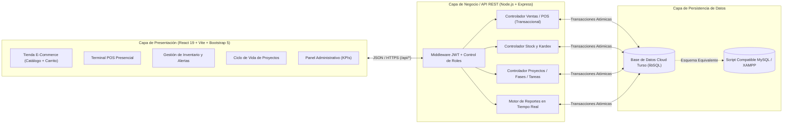
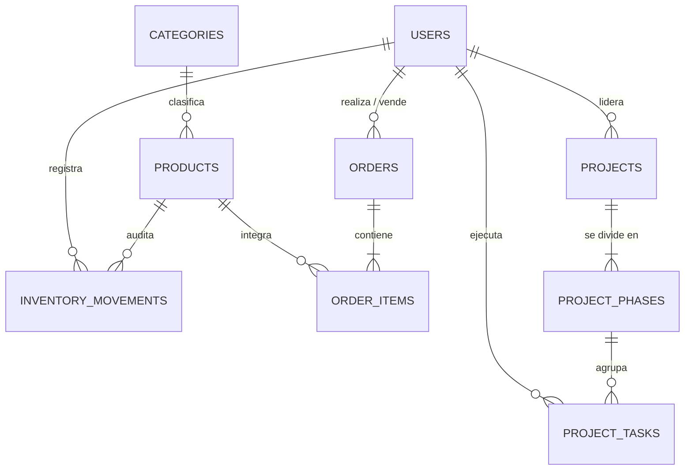

# 🎨 Diseño de Arquitectura y Prototipos de Pantallas (UI/UX)

## 1. Arquitectura General del Sistema (3 Capas)

---

## 2. Modelo Entidad-Relación de la Base de Datos

---

## 3. Estructura Visual de Pantallas (Wireframes & Sistema de Diseño)

### 3.1 Paleta de Colores y Modo Claro / Oscuro
- **Color Primario Deportivo:** `#FF4D24` (Naranja Energético Stride Pro).
- **Modo Claro (`data-bs-theme="light"`):** Fondo `#F4F6F9`, tarjetas `#FFFFFF`, texto `#111827`.
- **Modo Oscuro (`data-bs-theme="dark"`):** Fondo `#0B0F17`, tarjetas `#111827`, texto `#F3F4F6`.
- **Tipografía:** `Inter` (Google Fonts), jerarquía clara para precios, códigos SKU e indicadores KPI.

### 3.2 Mapa de Pantallas Implementadas
1. **Catálogo E-Commerce (`/`):** Banner promocional, buscador instantáneo, filtro por categoría deportiva, selector de talle en cada tarjeta, indicador de stock en vivo y modal de Carrito/Checkout.
2. **Terminal POS (`/pos`):** Diseño a dos columnas (grilla rápida de productos con filtro por SKU a la izquierda + ticket de caja con selector de cliente y descuento a la derecha).
3. **Inventario y Alertas (`/inventario`):** Banner superior de alerta para ítems con `stock <= min_stock`, pestañas de Productos, Alertas Críticas, Kardex de Movimientos y Categorías.
4. **Ciclo de Vida de Proyectos (`/proyectos`):** Tarjetas por proyecto con barra de progreso dinámica (`0% - 100%`), desglosadas en las 5 etapas (**Inicio, Planificación, Ejecución, Monitoreo y Control, Cierre**) y tabla interactiva de tareas.
5. **Panel Administrativo (`/admin`):** Tarjetas KPI superiores, comparativa porcentual Online vs POS, valorización de inventario, top 5 productos más vendidos y tabla de control de pedidos.
